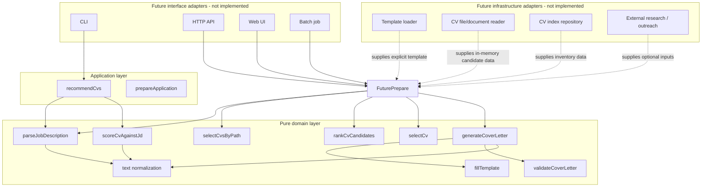
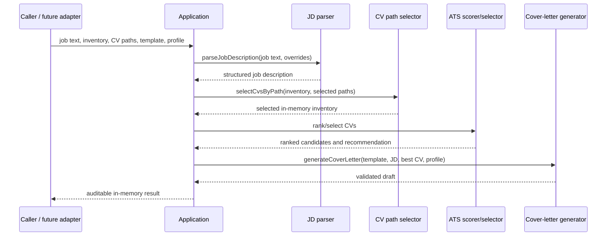
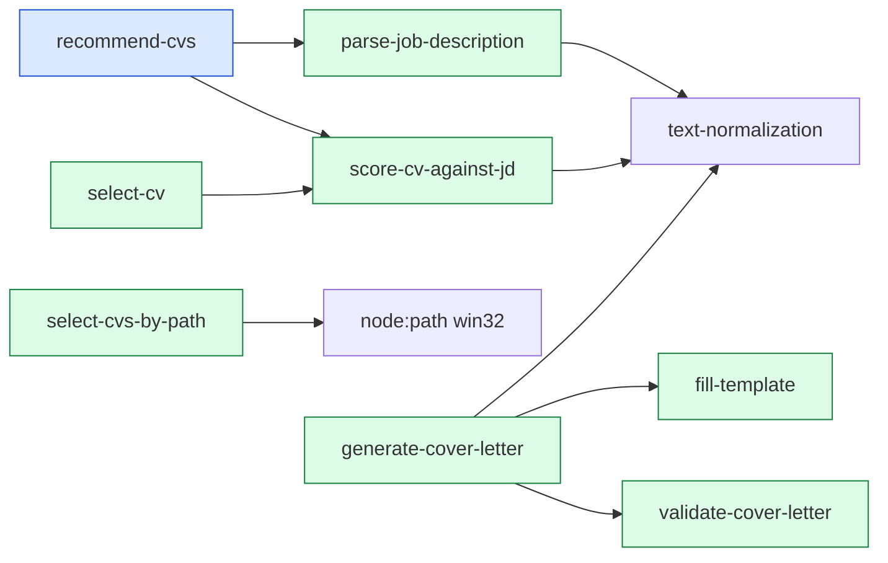

# NewModularProduct Architecture Document

The product now supports a controlled local application-preparation workflow.
It composes pure job-description parsing, CV selection and ATS assessment,
cover-letter generation, controlled template loading, CV inventory access,
guarded PDF extraction, a JSON CLI, and a local HTTP/browser review interface.

The implemented product deliberately does not perform organisation research,
cover-letter refinement through an external provider, recruiter discovery,
outreach queue management, Gmail OAuth, draft creation, email sending, or
automatic external communication.

---

## 1. Purpose and scope

`NewModularProduct` is a clean modular replacement for the safe, deterministic part of a legacy job-application workflow. The first implementation deliberately covers only pure, in-memory transformations:

1. Parse a job description into structured signals.
2. Select an in-memory CV subset by selected path identifiers.
3. Score, rank, and select CV candidates.
4. Generate and validate a cover-letter draft from explicit inputs.

The foundation does **not** read CV documents, load a default template from disk, access environment variables, call external APIs, use a database, start an HTTP server, send outreach, or depend on actual personal data.

The architecture is intended to make later adapters (CLI, HTTP, UI, file inventory, document extraction, template storage, integrations) replaceable without changing the domain rules.

---

## 2. Goals and non-goals

### 2.1 Goals

- Preserve verified legacy behavior where it is safe and useful.
- Make business rules deterministic, synchronous where possible, and directly unit-testable.
- Use explicit in-memory inputs and explicit outputs.
- Prevent secrets, local paths, files, databases, network access, and UI concerns from leaking into the domain core.
- Create a stable test-backed seam for later application orchestration.
- Correct one intentional legacy defect: preferred CV role codes should win score ties over unlisted role codes.

### 2.2 Non-goals in the current foundation

- CV/PDF/DOCX extraction or OCR.
- Persistent CV indexes, fingerprints, cache management, or repositories.
- Reading templates from disk.
- Loading `.env`, credentials, or API keys.
- Job-advert fetching, company research, recruiter finding, domain lookup, email generation, or dispatch.
- Browser/web UI, HTTP handlers, authentication, or user accounts.
- LLM refinement of cover letters.
- Use of real CVs, real personal profile data, or generated application files.

---

## 3. Architectural principles

1. **Functional core, imperative shell.** Domain logic is pure; effects enter through future adapters.
2. **Explicit dependencies.** Templates, candidate claims, inventories, job text, and selected identifiers are input data, never implicit global state.
3. **Domain first.** The core models job/CV/letter decisions before infrastructure such as files or databases.
4. **Test contracts over inferred behavior.** Legacy source and tests informed parity; each migration slice gained focused tests.
5. **No hidden personal content.** Candidate-specific claims are provided through `candidateProfile`, not hard-coded in generation logic.
6. **Determinism.** Ranking ties, path behavior, and text transformations have defined outcomes.
7. **One-directional dependencies.** Application orchestrates domain modules; domain modules never import application or infrastructure.

---

## 4. High-level design

### 4.1 Layer diagram



### 4.2 Current end-to-end data flow



`prepareApplication` is implemented as the composed local workflow. It parses
a job description, selects the intended CV subset, ranks and recommends CVs,
generates a validated cover-letter draft, and returns the intermediate evidence
needed for local review. `recommendCvs` remains a smaller parse-and-rank use case.
---

## 5. Repository structure

```text
NewModularProduct/
├─ package.json
├─ .gitignore
├─ .gitattributes
├─ src/
│  ├─ application/
│  │  └─ recommend-cvs.js
│  └─ domain/
│     ├─ shared/
│     │  └─ text-normalization.js
│     ├─ job-description/
│     │  └─ parse-job-description.js
│     ├─ cv/
│     │  ├─ score-cv-against-jd.js
│     │  ├─ select-cv.js
│     │  └─ select-cvs-by-path.js
│     └─ cover-letter/
│        ├─ fill-template.js
│        ├─ validate-cover-letter.js
│        └─ generate-cover-letter.js
└─ tests/
   ├─ application/
   │  └─ recommend-cvs.test.js
   └─ domain/
      ├─ parse-job-description.test.js
      ├─ score-cv-against-jd.test.js
      ├─ select-cv.test.js
      ├─ select-cvs-by-path.test.js
      └─ cover-letter/
         ├─ fill-template.test.js
         ├─ validate-cover-letter.test.js
         └─ generate-cover-letter.test.js
```

---

## 6. Domain model

The current foundation intentionally accepts legacy-compatible snake_case CV fields at its boundary. This preserves compatibility with the known legacy data contract. A later adapter may map external records into an internal camelCase model, but that is not required for the current slice.

### 6.1 Parsed job description

```js
{
  rawText: string,
  role: string,
  seniority: string[],
  domain: string[],
  methodologies: string[],
  keywords: string[],
  location: string[],
  scClearanceRequired: boolean
}
```

### 6.2 Candidate CV input

```js
{
  id?: string,
  role_code?: string,
  role_name?: string,
  text?: string,
  tags?: string[],
  use_cases?: string[],
  priority?: 'very-high' | 'high' | 'medium' | 'low' | string,
  local_path?: string,
  filename?: string,
  folder?: string,
  recency?: string
}
```

### 6.3 ATS assessment

```js
{
  score: number,
  matchedKeywords: string[],
  missingKeywords: string[],
  suggestions: string[],
  components: {
    keywordMatch: number,
    useCaseAlignment: number,
    roleCategory: number,
    priorityRecency: number
  }
}
```

### 6.4 Ranked candidate and recommendation

```js
{
  cv: CandidateCv,
  ats: AtsAssessment
}
```

```js
{
  bestCv: CandidateCv,
  alternativeCv: CandidateCv | null,
  ats: AtsAssessment
}
```

### 6.5 Cover-letter result

```js
{
  subject: string,
  richText: string,
  plainText: string,
  validation: {
    valid: boolean,
    errors: string[],
    wordCount: number
  },
  variant: string,
  variantLabel: string,
  templateBody: string,
  companyValues: string,
  refinedCoverLetter: string,
  highlightPhrases: string[]
}
```

---

## 7. Low-level module design

### 7.1 Shared text normalization

**Module:** `src/domain/shared/text-normalization.js`

Responsibilities:

- Convert values to normalized lower-case text.
- Tokenize text.
- Remove duplicate values.
- Find term overlap between JD terms and CV text.

This module is reused by job parsing, ATS scoring, and cover-letter highlighting. It has no side effects.

### 7.2 Job-description parser

**Module:** `src/domain/job-description/parse-job-description.js`

**Public API:**

```js
parseJobDescription(text = '', overrides = {})
```

Responsibilities:

- Infer a role from the first non-empty input line.
- Honor explicit `overrides.role` and `overrides.location`.
- Detect configured seniority, domain, methodology, and location terms.
- Derive keyword tokens while removing common filler words.
- Detect SC/security-clearance wording.

Key behavior:

- Empty/blank input produces role `Unspecified role`.
- Locations in `overrides.location` split on commas, semicolons, slashes, and vertical bars.
- It does not validate whether claimed clearance is real; it only detects a job requirement signal.

### 7.3 ATS scoring

**Module:** `src/domain/cv/score-cv-against-jd.js`

**Public API:**

```js
scoreCvAgainstJd(jobDescription, cv)
```

Scoring corpus is built from:

```text
cv.text + cv.role_name + cv.role_code + cv.tags + cv.use_cases
```

Scoring formula:

\[
score = \min(100, \operatorname{round}(K + U + R + P))
\]

Where:

| Component | Rule | Maximum |
|---|---|---:|
| `K`: keyword match | Fraction of JD keywords present in CV corpus × 40 | 40 |
| `U`: use-case alignment | JD keyword overlap with use cases, scaled × 30 and capped | 30 |
| `R`: role category | Role containment match or seniority overlap | 20 or 10 |
| `P`: priority/recency | `very-high`: 10, `high`: 7, `medium`: 5, `low`: 2 | 10 |

The scorer returns missing terms and suggestions whenever score is below 85. Suggestions are advisory text, not a statement of candidate truth.

### 7.4 CV ranking and selection

**Module:** `src/domain/cv/select-cv.js`

Public APIs:

```js
rankCvCandidates(jobDescription, inventory, preferredRoleCodes = [])
selectCv(jobDescription, inventory, preferredRoleCodes = [])
```

Accepted inventory shapes:

```js
{ cvs: [...] }
```

or:

```js
{ cv_inventory: { cvs: [...] } }
```

Ranking policy:

1. Higher ATS score ranks first.
2. If scores tie, listed `preferredRoleCodes` rank first.
3. Earlier entries in `preferredRoleCodes` rank earlier.
4. If score and preference rank tie, original input order is retained.

An empty inventory throws:

```text
CV inventory contains no CV entries.
```

#### Intentional compatibility improvement

The legacy selector used `indexOf()` directly, which gives unlisted role codes rank `-1`; an unlisted CV could therefore outrank an explicitly preferred CV in an ATS-score tie. The new policy assigns unlisted codes a rank after all listed preferences.

### 7.5 Path-based candidate subset

**Module:** `src/domain/cv/select-cvs-by-path.js`

**Public API:**

```js
selectCvsByPath(inventory, selectedCvPaths = [])
```

Responsibilities:

- Return the original inventory reference when no paths are selected.
- Support both legacy inventory shapes.
- Preserve caller-specified selected-path order.
- Reuse existing CV objects whose normalized `local_path` matches a selected path.
- Create analyzable synthetic metadata for previously unknown path identifiers.

Path policy:

- Uses `node:path` `win32` behavior deliberately, because the verified legacy contract uses Windows-style paths.
- Does not read a file, test a file’s existence, or open a directory.
- Treats paths as data identifiers.
- Does not deduplicate duplicate selections; duplicate selected paths remain duplicate records.

Synthetic CV shape:

```js
{
  role_code: 'CUSTOM-<n>',
  role_name: string,
  filename: string,
  folder: string,
  local_path: string,
  tags: string[],
  use_cases: [],
  priority: 'medium',
  recency: ''
}
```

### 7.6 Cover-letter template fill

**Module:** `src/domain/cover-letter/fill-template.js`

**Public API:**

```js
fillTemplate(template, values)
```

Supported syntax is `{{token}}`, including whitespace inside braces. Missing values become `''`, preventing literal `undefined` or `null` interpolation.

### 7.7 Cover-letter validation

**Module:** `src/domain/cover-letter/validate-cover-letter.js`

**Public API:**

```js
validateCoverLetter({ plainText, richText })
```

Returns:

```js
{ valid, errors, wordCount }
```

Validation currently performs intentionally simple string-level checks:

- Unknown unresolved tokens are invalid.
- Known template tokens remain valid when intentionally unresolved, notably `{{firstname}}`.
- Generic filler strings (`about, job, role`, `undefined`, `null`) are invalid.
- Rich text must include an `<a href=` fragment.

It does not parse, sanitize, or validate full HTML. A future presentation/security layer should introduce robust HTML generation and sanitization if untrusted inputs are accepted.

### 7.8 Cover-letter generation

**Module:** `src/domain/cover-letter/generate-cover-letter.js`

**Public API:**

```js
generateCoverLetter({
  template,
  jobDescription,
  jd,
  cv,
  bestCv,
  candidateProfile,
  recruiter,
  recruiterName,
  companyValues,
  refinedCoverLetter,
  finalCoverLetter,
  atsScore,
  cvHighlights,
  jdKeywords,
  domainMapping,
  variantProfiles,
  variant,
  jobAdvertLink,
  jobReference,
  highlightPhrases
})
```

`jobDescription` is the preferred name; `jd` is supported for compatibility. `cv` is preferred; `bestCv` is supported for compatibility.

Key rules:

- Requires a non-empty template; no disk fallback exists.
- Uses supplied recruiter name, or preserves `{{firstname}}` for downstream outreach personalization.
- Uses CV highlights/use cases as evidence input.
- Builds a subject from role, job-advert context, job reference, and supplied candidate display name.
- Cleans numeric citation markers such as `[1][2]` from refined/final input.
- Normalizes the greeting for refined text.
- Ensures the ATS-redirection paragraph occurs before recognized closing/sign-off patterns.
- Builds rich text from plain text and applies limited phrase highlights.
- Keeps highlight markup out of plain text.
- Validates the final plain/rich result.

Candidate-specific claims are passed in explicitly:

```js
{
  displayName?: string,
  currentRoleEvidence?: string,
  defaultDomainValues?: string,
  uaeResidencyNote?: string,
  clearanceNote?: string
}
```

No personal name, employment claim, or residence/clearance claim is hard-coded in the modular core.

---

## 8. Dependency graph



Only `select-cvs-by-path.js` imports a Node built-in (`node:path`), and it uses it solely for deterministic path-string normalization. There are no imports of filesystem, network, environment, process configuration, database, or external SDK modules in the implemented domain core.

---

## 9. Application layer

### 9.1 Implemented: `recommendCvs`

**Module:** `src/application/recommend-cvs.js`

**Public API:**

```js
recommendCvs({
  jobDescriptionText = '',
  cvs = [],
  overrides = {}
} = {})
```

Behavior:

1. Parses the supplied JD text.
2. Scores every input CV.
3. Ranks by descending ATS score.
4. Preserves input order for equal scores.
5. Returns the parsed JD and ranked records.

Output:

```js
{
  jobDescription,
  rankedCvs: [
    { cv, assessment }
  ]
}
```

### 9.2 Planned: `prepareApplication`

The next application workflow should compose existing pure policies without copying legacy `runAgent()`:

```js
prepareApplication({
  jobDescriptionText,
  inventory,
  selectedCvPaths = [],
  preferredRoleCodes = [],
  jobDescriptionOverrides = {},
  coverLetterTemplate,
  candidateProfile = {},
  recruiterName = '',
  companyValues = [],
  jobAdvertLink = '',
  jobReference = '',
  variant = 'default',
  variantProfiles = {},
  domainMapping = {}
})
```

Expected output:

```js
{
  jobDescription,
  selectedInventory,
  rankedCvs,
  recommendation,
  coverLetter
}
```

Planned sequence:

```text
parse JD
  → select path subset
  → rank CVs
  → select best/alternative CV
  → generate validated cover letter
  → return all intermediate evidence
```

This use case will remain in-memory and side-effect free.

---

## 10. Testing strategy

### 10.1 Test runner

```text
Node.js built-in test runner: node --test
```

### 10.2 Baseline

At document time:

```text
114 Node tests
114 passing
0 failing

2 Chromium Playwright tests
2 passing
0 failing
```

### 10.3 Test layers

| Layer | Test focus |
|---|---|
| Domain: JD | Role inference, method/location/clearance detection, stop-word behavior, overrides |
| Domain: ATS | Keyword and priority alignment, CV text influence, clearance advice |
| Domain: selection | Inventory shape, empty inventory error, preferred code tie-breaker, stable order, alternative selection |
| Domain: path selection | Existing path matching, selection order, synthetic records, duplicate selections, no-path identity behavior |
| Domain: cover letter | Token replacement, token validation, greeting behavior, evidence, citation cleanup, ATS paragraph, rich text highlighting, explicit template requirement |
| Application | Full in-memory parse-and-rank workflow and tie stability |

### 10.4 Test philosophy

- Use synthetic job descriptions, CVs, path strings, and templates.
- Do not use real candidate CV files or external resources.
- Test behavior at public function boundaries.
- Treat every intentional divergence from legacy behavior as a named test and documented decision.

---

## 11. Security, privacy, and operational boundaries

### 11.1 Current safety properties

The implemented core:

- Does not load `.env`.
- Does not access `process.env`.
- Does not make network requests.
- Does not read/write user CV files.
- Does not use a database or cache.
- Does not send messages or create external records.
- Does not contain API keys or integration credentials.
- Does not hard-code an individual candidate’s name, employer, CV content, clearance status, or residence.

### 11.2 Input trust considerations

Current template and rich-text behavior assumes controlled template input. Future user-supplied HTML or untrusted text must introduce:

- output encoding or safe HTML construction,
- HTML sanitization,
- URL validation,
- stronger schema validation,
- audit logging at an application/adaptor boundary.

### 11.3 Future adapters

Future effects must sit outside `src/domain`:

| Future concern | Recommended location |
|---|---|
| Load templates from files/object storage | `src/infrastructure/templates/` |
| Read CV documents and extract text | `src/infrastructure/documents/` |
| Persistent CV inventory/index | `src/infrastructure/cv-index/` |
| Environment/configuration | `src/config/` or composition root |
| HTTP/CLI/UI | `src/interfaces/` |
| Company research and LLM refinement | `src/integrations/` |
| Outreach/email dispatch | `src/integrations/outreach/` |

Adapters may map external data into the current domain input shapes, but must not cause domain modules to import those adapters.

---

## 12. Legacy-to-modular mapping

| Legacy capability | Modular replacement | Current status |
|---|---|---|
| `jd-parser.js` | `domain/job-description/parse-job-description.js` | Implemented |
| `ats-engine.js` | `domain/cv/score-cv-against-jd.js` | Implemented |
| `cv-selector.js` | `domain/cv/select-cv.js` | Implemented, with corrected tie policy |
| `agent.js::inventoryForPaths` | `domain/cv/select-cvs-by-path.js` | Implemented; no file access |
| `cover-letter-generator.js` | `domain/cover-letter/generate-cover-letter.js` | Implemented; explicit template/profile inputs |
| `content-validator.js` | `domain/cover-letter/validate-cover-letter.js` | Implemented |
| `utils.js::fillTemplate` | `domain/cover-letter/fill-template.js` | Implemented |
| `runAgent()` | `application/prepare-application.js` | Planned, intentionally not copied |
| CV indexing/enrichment | Infrastructure adapter | Deferred |
| HTTP/UI/outreach/research | Interfaces/integrations | Deferred |

---

## 13. Known limitations and intentional deferrals

1. **No end-to-end composed application workflow yet.** `recommendCvs` exists; `prepareApplication` is the next composition step.
2. **Legacy-compatible CV field names remain.** A boundary mapper can later introduce a normalized internal candidate schema.
3. **Windows path policy is explicit.** This supports current legacy path identifiers but is not yet a general cross-platform document identity model.
4. **Cover-letter validation is deliberately lightweight.** It uses string checks; it is not HTML sanitization or semantic truth verification.
5. **ATS logic is keyword based.** It is explainable and deterministic, but it does not understand semantics, evidence quality, dates, or verified clearance status.
6. **Synthetic path-derived metadata is provisional.** It is useful for candidate selection but does not extract actual document content.
7. **No persistence.** All inputs and outputs are in-memory.

---

## 14. Next-stage plan

### Stage 1: Compose the pure workflow

Implement and test `prepareApplication` as a pure application service.

Acceptance criteria:

- Accepts all inputs explicitly.
- Uses selected path policy before ranking.
- Returns parsed JD, selected inventory, ranking, recommendation, and cover-letter draft.
- Has one or more fully synthetic end-to-end tests.
- Performs no I/O or external calls.

### Stage 2: Define ports for infrastructure

Define interfaces such as:

```js
TemplateRepository.load(templateId)
CvInventoryRepository.list()
DocumentTextExtractor.extract(path)
```

Do not implement external integrations until their contracts, error behavior, and privacy constraints are specified.

### Stage 3: Add adapters one at a time

Suggested order:

1. Template loader adapter.
2. File/inventory loader adapter with synthetic integration tests.
3. CV text-extraction adapter.
4. CLI or HTTP interface.
5. Optional company research/refinement behind explicit ports.
6. Outreach only after separate safety, confirmation, and audit design.

---

## 15. Change-management rules

- Keep domain changes accompanied by tests.
- Use explicit staging rather than `git add .`.
- Never commit `.env`, local CV files, databases, generated output, cache files, or secrets.
- Preserve green tests before beginning a new slice.
- Document deliberate departures from legacy behavior.
- Do not migrate large orchestration modules wholesale; extract one pure, verified policy at a time.

---

## 16. Current checkpoint summary

The repository has a tested, secret-free foundation for application preparation decisions. It can parse a JD, select and assess in-memory candidates, choose a best/alternative CV, and create a validated cover-letter draft from explicit input data. This is the appropriate stopping point before composing the first full pure application workflow.
