# NewModularProduct — Full Legacy Product Migration Plan and Status

**Status date:** 1 October 2026  
**Current implemented baseline:** 31 passing tests, 0 failures (`node --test`)  
**Purpose:** Cover the complete legacy product capability map while clearly separating implemented, planned, deferred, and explicitly excluded work.

## Executive status

The current modular product implements only the **safe, deterministic application-preparation core**. It does not yet reproduce the full legacy product. In particular, the following legacy capability areas remain outside the implementation:

- interactive web UI and browser state;
- Gmail/OAuth-backed email draft/send workflows;
- organization-value research through Perplexity or another research provider;
- Perplexity-backed cover-letter review/refinement;
- recruiter discovery/ranking and organization email-domain lookup;
- CV file indexing, document extraction, persistent cache/repository behavior;
- CV rebuilding;
- HTTP server, web routing, and output persistence.

These should be added as separate slices through ports/adapters, not imported from the monolith into the domain core.

## Full capability plan

| # | Legacy capability area | Modular target | Status | Design boundary / requirements |
|---:|---|---|---|---|
| 1 | Job-description parsing | `parseJobDescription()` | Complete | Pure domain module; no external dependency |
| 2 | ATS scoring | `scoreCvAgainstJd()` | Complete | Pure domain module; explainable score components |
| 3 | CV ranking/selection | `rankCvCandidates()` / `selectCv()` | Complete | Pure policy; documented improvement to preference tie-breaker |
| 4 | Selected CV paths | `selectCvsByPath()` | Complete | Pure path-identifier policy; no file reads |
| 5 | Cover-letter generation | `generateCoverLetter()` / validator / template fill | Complete | Explicit template and candidate profile; no disk fallback |
| 6 | End-to-end preparation | `prepareApplication()` | Complete | In-memory JD → candidate selection → validated draft |
| 7 | JSON command boundary | stdin JSON → `prepareApplication()` → stdout JSON | Ready to start | Safe first interface; no hidden defaults or secrets |
| 8 | Web/interactive UI | Interface calling application services | Planned | UI state, form validation, rendering, copy/export; no business rules in browser code |
| 9 | HTTP server/API | API adapter around application services | Planned | Authentication, request schemas, error mapping, rate limits; no direct domain coupling |
| 10 | CV inventory loading | `CvInventoryRepository` port and adapter | Planned | Read approved metadata store; map to domain candidates; sensitive-data policy required |
| 11 | CV document extraction/indexing | `DocumentTextExtractor` and indexing adapter | Planned | Local file validation, extraction failures, caching/fingerprint policy, privacy controls |
| 12 | CV rebuilding | `CvRebuilder` port/adapter | Planned | Separate output-generation workflow; template/versioning, review, output directory safety |
| 13 | Template storage/loading | `TemplateRepository` port/adapter | Planned | Explicit template IDs/versions; no hidden cwd fallback |
| 14 | Organization values research | `CompanyResearchPort` with provider adapter | Planned | Research request/response schema, freshness metadata, source/citation handling, cache and consent policy |
| 15 | Perplexity organization research | Perplexity-backed `CompanyResearchPort` adapter | Deferred pending provider design | API key isolation, data minimization, explicit organization input, failure/cost/rate-limit handling |
| 16 | Cover-letter review/refinement | `CoverLetterRefinementPort` | Planned | Input redaction policy, structured review output, preserve human-approved draft, no automatic send |
| 17 | Perplexity cover-letter review | Perplexity-backed refinement adapter | Deferred pending provider design | API key isolation; send minimum necessary text; citations/claims validation; human review required |
| 18 | Recruiter discovery/finding | `RecruiterFinderPort` | Planned | Separate research workflow; confidence/attribution; no implicit contact enrichment |
| 19 | Recruiter ranking | Pure ranking policy plus input adapter | Planned | Ranking rules must be inspected/defined; provide explanations and deterministic tie rules |
| 20 | Organization email-domain lookup | `EmailDomainLookupPort` | Planned | Normalize/corroborate domains; distinguish verified, inferred, and unknown values |
| 21 | Recruiter TSV/export queue | Output/export adapter | Planned | Explicit output location; data minimization; no automatic dispatch |
| 22 | Gmail authorization | `EmailProviderPort` OAuth adapter | Deferred; high-risk | OAuth credential storage, token refresh, least privilege, account resolution, revocation/expiry behavior |
| 23 | Gmail draft creation | `EmailProviderPort.createDraft()` | Deferred; external side effect | Resolve account/recipient first; show exact subject/body; require confirmation before creation if policy demands |
| 24 | Gmail email sending | `EmailProviderPort.send()` | Deferred; irreversible communication | Explicit per-message confirmation, resolved recipient, final exact content, audit record, retry/idempotency policy |
| 25 | Outreach queue and dispatch | Application workflow over explicit queued items | Deferred; high-risk | Separate queue state, review gates, rate limits, duplicate prevention, delivery status tracking |
| 26 | Company/recruiter caches | Infrastructure cache adapter | Planned after port contracts | TTL/freshness, invalidation, encrypted/local storage policy, no cache access from domain |
| 27 | Persistent application output | Output repository/export adapter | Planned | Explicit user-selected destination; safe filenames; avoid accidental sensitive data retention |
| 28 | Secret/configuration management | Configuration composition root | Planned before integrations | Environment/config provider at outer boundary; never import into domain |
| 29 | Observability/audit trail | Structured application/integration event layer | Planned before email/research production use | Redact personal content/secrets; retain actionable lifecycle metadata |
| 30 | Security/privacy review | Threat model and data-handling policy | Required before real data/integrations | CV PII, email addresses, OAuth tokens, API prompts/responses, retention, access controls |

## Full target architecture

```mermaid
flowchart TB
  subgraph Interfaces[Interfaces]
    UI[Interactive Web UI]
    CLI[JSON CLI]
    API[HTTP API]
  end

  subgraph Application[Application services]
    Prepare[Prepare application]
    Research[Research organization]
    Refine[Review/refine cover letter]
    Queue[Create/review outreach queue]
    Dispatch[Dispatch approved outreach]
  end

  subgraph Domain[Pure domain]
    JD[JD parsing]
    ATS[ATS score/rank/select]
    Letter[Cover letter generation/validation]
    RecruiterPolicy[Recruiter ranking policy]
    QueuePolicy[Outreach policy]
  end

  subgraph Ports[Ports]
    InventoryPort[CV inventory repository]
    ExtractPort[Document text extractor]
    TemplatePort[Template repository]
    ResearchPort[Company research port]
    RefinePort[Cover letter refinement port]
    RecruiterPort[Recruiter finder port]
    DomainPort[Email-domain lookup port]
    EmailPort[Email provider port]
    OutputPort[Output/export repository]
    AuditPort[Audit/event port]
  end

  subgraph Adapters[Infrastructure adapters]
    Files[File/index/document adapters]
    Perplexity[Perplexity API adapter]
    Gmail[Gmail OAuth/API adapter]
    Storage[Cache/output storage adapter]
  end

  UI --> Prepare
  UI --> Research
  UI --> Refine
  UI --> Queue
  UI --> Dispatch
  CLI --> Prepare
  API --> Prepare

  Prepare --> JD
  Prepare --> ATS
  Prepare --> Letter
  Research --> ResearchPort
  Refine --> RefinePort
  Queue --> RecruiterPolicy
  Queue --> QueuePolicy
  Dispatch --> EmailPort

  Prepare --> InventoryPort
  Prepare --> TemplatePort
  Prepare --> ExtractPort
  Research --> RecruiterPort
  Research --> DomainPort
  Queue --> OutputPort
  Dispatch --> AuditPort

  InventoryPort --> Files
  ExtractPort --> Files
  TemplatePort --> Files
  ResearchPort --> Perplexity
  RefinePort --> Perplexity
  RecruiterPort --> Perplexity
  DomainPort --> Perplexity
  EmailPort --> Gmail
  OutputPort --> Storage
  AuditPort --> Storage
```



## Recommended implementation order

### Phase A — Complete safe local product boundaries

1. Finish JSON CLI interface and tests.
2. Add an explicit request/response schema validator at the CLI/API boundary.
3. Add a controlled template repository adapter.
4. Add a metadata-only CV inventory adapter using synthetic data first.
5. Add CV document extraction/indexing only after sensitive-data rules are agreed.
6. Add a UI or HTTP API after the workflow inputs/outputs have stabilized.

### Phase B — Add research and review as explicit provider ports

7. Define `CompanyResearchPort` and structured research result types.
8. Implement a deterministic fake adapter for tests.
9. Implement a Perplexity adapter outside the domain, with injected configuration.
10. Add source/freshness metadata and user-visible review of organization values.
11. Define `CoverLetterRefinementPort` and a structured review/refinement result.
12. Add a fake adapter for tests, then a Perplexity adapter with data minimization.
13. Require the user to review/accept the refined text before it becomes a final draft.

### Phase C — Add recruiter and outreach preparation

14. Define recruiter finding, ranking, and email-domain lookup contracts.
15. Implement recruiter TSV/export and a reviewable outreach queue.
16. Add deduplication, queue states, and recipient/data-quality checks.

### Phase D — Add Gmail only behind explicit safety gates

17. Define `EmailProviderPort` with separate `createDraft` and `send` operations.
18. Implement OAuth token handling in an adapter; keep tokens outside source control and domain code.
19. Resolve the actual Gmail account and recipient before any write action.
20. Require an explicit user confirmation that displays exact recipient, subject, and body before creating/sending each message.
21. Add audit events, idempotency protections, rate limiting, and failure/retry handling.
22. Start with Gmail draft creation; introduce actual sending only after draft/review flows are proven.

## Perplexity API safety requirements

Perplexity-powered organization research and cover-letter review are distinct workflows and should not share an implicit global client.

### Organization values research

Input should be minimal and explicit:

```js
{
  companyName,
  companyUrl?: '',
  jobDescriptionSummary?: '',
  forceRefresh?: false
}
```

Output should carry provenance/freshness:

```js
{
  status: 'found' | 'not-found' | 'error',
  companyValues: string[],
  summary: string,
  sources: [{ title, url }],
  researchedAt: string,
  provider: 'perplexity',
  error?: string
}
```

### Cover-letter review/refinement

Input should contain only the necessary draft/context; exclude secrets and unnecessary personal details:

```js
{
  draftPlainText,
  jobDescriptionSummary,
  selectedCvHighlights,
  companyValues: [],
  instructions: ''
}
```

The result should separate review from replacement:

```js
{
  review: {
    strengths: string[],
    risks: string[],
    unsupportedClaims: string[],
    suggestedChanges: string[]
  },
  proposedDraft: string,
  citations: [],
  provider: 'perplexity'
}
```

A refinement result must not automatically become an email body or be sent. It requires human review and acceptance.

## Gmail/outreach safety requirements

Gmail is a side-effecting integration and belongs at the outermost layer.

Required controls before enabling send:

- OAuth credentials/tokens stored outside source control and outside the domain core.
- Minimum practical OAuth scope and explicit connected-account display.
- Exact recipient resolution, including name/email/domain validation.
- Separate draft creation from sending.
- User confirmation for each irreversible operation, showing exact recipient, subject, body, attachments, and sending account.
- Queue states such as `draft`, `review-required`, `approved`, `sent`, `failed`, `cancelled`.
- Duplicate prevention and idempotency keys.
- Rate limits and error/retry policy.
- Auditable, privacy-aware event records without logging secrets or full CV text unnecessarily.

## Current versus target scope

```text
Implemented now
  Pure JD → CV recommendation → validated cover-letter draft

Next safe product boundary
  JSON CLI over the pure workflow

Later controlled adapters
  Templates / CV metadata / document extraction / UI or HTTP

Later provider workflows
  Organization research and cover-letter review through Perplexity

Last high-risk workflow
  Gmail OAuth, draft creation, reviewed outreach queue, explicit sending
```

## Milestone reconciliation - 10 October 2026

This section supersedes the earlier current-baseline, executive-status,
and immediate-next-action statements. The original capability plan and
implementation order remain in effect.

### Delivered since the original baseline

- JSON application-preparation CLI and command tests.
- Controlled template and JSON CV inventory adapters.
- Local PDF text extraction; full indexing/cache is not confirmed complete.
- Local HTTP application preparation and interactive review interface.
- Organisation research through an explicit Perplexity adapter.
- Cover-letter refinement proposals with explicit user acceptance.
- Contact import, persistence, linking, unlinking, and deletion workflows.
- Per-import business-domain selection in LinkedIn userscript version 0.4.1.

### Latest completed checkpoint

- Commit: 4f45966 - Move LinkedIn userscript and replace hardcoded import domain.
- Live validation: version 0.4.1, entered ageas.co.uk, generated candidate
  nico.detullio@ageas.co.uk, no reported error.
- This validates candidate-domain handling, not mailbox verification.
- Agreed repository cleanup checkpoint is closed.
- Last reported test baseline: 239 Node tests and 14 browser tests passing.
  These tests were not rerun for this documentation update.

### Outstanding and deferred scope

- Automated recruiter discovery/ranking is not established as delivered.
- Recruiter TSV/export and reviewable outreach preparation remain the next
  planned delivery area, subject to checking existing implementation.
- Older-duplicate review-domain projection remains deferred unless it blocks
  the next delivery.
- Full CV indexing/cache, CV rebuilding, and persistent application output
  are not established as complete.
- Gmail OAuth, draft creation, and sending remain deferred behind Phase D gates.

### Delivery focus

Follow the existing roadmap. Deliver the smallest useful vertical slice,
use focused validation, and record status/evidence at each milestone.
Do not reopen cleanup or add speculative refactoring as prerequisites.

Next delivery slice: persistent local outreach queue from selected linked
contacts, with explicit recipient selection and message review. Gmail draft
creation follows, then explicitly approved sending. TSV export is optional.
