# NewModularProduct — Full Legacy Product Migration Plan and Status

**Status date:** 4 October 2026  
**Current implemented baseline:** 127 passing Node tests and 2 passing Chromium Playwright tests, 0 failures  

## Executive status

The modular product now provides a controlled local application-preparation
workflow. It can accept structured job inputs, parse the job description,
load a controlled template and validated CV inventory, safely extract local PDF
text when explicitly requested, rank and recommend CVs, generate a validated
cover-letter draft, and present the result in a local HTTP/browser interface.

The local UI supports reviewable vacancy details, HTTP(S)-only job-advert links,
local cover-letter copying, manual-send messaging, escaped rendering, and
per-response CSP nonce controls. It does not send applications or email.

The following high-risk or provider-backed capabilities remain outside the
implementation:

- organisation-values research through Perplexity or another research provider;
- Perplexity-backed cover-letter review/refinement;
- recruiter discovery, recruiter ranking, and organisation email-domain lookup;
- recruiter TSV/export and persistent outreach queues;
- CV rebuilding;
- Gmail OAuth, Gmail draft creation, email sending, and dispatch audit workflows;
- production-grade provider cache, retention, and integration observability.

These remain separate port-and-adapter slices. They must not be imported from a
legacy monolith into the domain core.

## Full capability plan

| # | Legacy capability area | Modular target | Status | Design boundary / requirements |
|---:|---|---|---|---|
| 1 | Job-description parsing | `parseJobDescription()` | Complete | Pure domain module; no external dependency |
| 2 | ATS scoring | `scoreCvAgainstJd()` | Complete | Pure domain module; explainable score components |
| 3 | CV ranking/selection | `rankCvCandidates()` / `selectCv()` | Complete | Pure policy; documented improvement to preference tie-breaker |
| 4 | Selected CV paths | `selectCvsByPath()` | Complete | Pure path-identifier policy; no file reads |
| 5 | Cover-letter generation | `generateCoverLetter()` / validator / template fill | Complete | Explicit template and candidate profile; no disk fallback |
| 6 | End-to-end preparation | `prepareApplication()` | Complete | In-memory JD → candidate selection → validated draft |
| 7 | JSON command boundary | stdin JSON → `prepareApplication()` → stdout JSON | Complete | Validates JSON input, executes the complete workflow, and writes exactly one JSON response |
| 8 | Web/interactive UI | Local interface calling application services | Complete | Local application form, validation, escaped rendering, review controls, copy fallback, and no business rules in browser code |
| 9 | HTTP server/API | Local HTTP adapter around application services | Complete for local use | Route, media-type, request-size, validation, error, safe-rendering, and CSP controls are tested; authentication and production rate limits remain future scope |
| 10 | CV inventory loading | `CvInventoryRepository` adapter | Complete | Loads and validates approved metadata; normalizes supported shapes; rejects invalid or duplicate candidate entries |
| 11 | CV document extraction/indexing | `DocumentTextExtractor` and indexing adapter | Partially complete | Guarded local PDF extraction and safe path resolution are implemented; persistent indexing, cache, and fingerprint policy remain planned |
| 12 | CV rebuilding | `CvRebuilder` port/adapter | Planned | Separate output-generation workflow; template/versioning, review, output directory safety |
| 13 | Template storage/loading | `TemplateRepository` adapter | Complete | Validated template IDs and controlled Markdown template loading; no implicit cwd fallback |
| 14 | Organization values research | `CompanyResearchPort` with provider adapter | Planned | Research request/response schema, freshness metadata, source/citation handling, cache and consent policy |
| 15 | Perplexity organization research | Perplexity-backed `CompanyResearchPort` adapter | Deferred pending provider design | API key isolation, data minimization, explicit organization input, failure/cost/rate-limit handling |
| 16 | Cover-letter review/refinement | `CoverLetterRefinementPort` | Planned | Input redaction policy, structured review output, preserve human-approved draft, no automatic send |
| 17 | Perplexity cover-letter review | Perplexity-backed refinement adapter | Deferred pending provider design | API key isolation; send minimum necessary text; citations/claims validation; human review required |
| 18 | Recruiter discovery/finding | `RecruiterFinderPort` | Planned | Separate research workflow; confidence/attribution; no implicit contact enrichment |
| 19 | Recruiter ranking | Pure ranking policy plus input adapter | Planned | Ranking rules must be inspected/defined; provide explanations and deterministic tie rules |
| 20 | Organization email-domain lookup | `EmailDomainLookupPort` | Planned | Normalize/corroborate domains; distinguish verified, inferred, and unknown values |
| 21 | Recruiter TSV/export queue | Output/export adapter | Planned | Explicit output location; data minimization; no automatic dispatch |
| 22 | Gmail authorization | `EmailProviderPort` OAuth adapter | Deferred; high-risk | OAuth credential storage, token refresh, least privilege, account resolution, revocation/expiry behavior |
| 23 | Gmail draft creation | `EmailProviderPort.createDraft()` | Deferred; external side effect | Resolve account/recipient first; show exact subject/body; require confirmation before creation if policy demands |
| 24 | Gmail email sending | `EmailProviderPort.send()` | Deferred; irreversible communication | Explicit per-message confirmation, resolved recipient, final exact content, audit record, retry/idempotency policy |
| 25 | Outreach queue and dispatch | Application workflow over explicit queued items | Deferred; high-risk | Separate queue state, review gates, rate limits, duplicate prevention, delivery status tracking |
| 26 | Company/recruiter caches | Infrastructure cache adapter | Planned after port contracts | TTL/freshness, invalidation, encrypted/local storage policy, no cache access from domain |
| 27 | Persistent application output | Output repository/export adapter | Planned | Explicit user-selected destination; safe filenames; avoid accidental sensitive data retention |
| 28 | Secret/configuration management | Configuration composition root | Complete for local use | Validates runtime feature configuration and redacts API/OAuth secrets from diagnostics; provider credential lifecycle remains outside the domain |
| 29 | Observability/audit trail | Structured application/integration event layer | Planned before email/research production use | Redact personal content/secrets; retain actionable lifecycle metadata |
| 30 | Security/privacy review | Threat model and data-handling policy | Required before real data/integrations | CV PII, email addresses, OAuth tokens, API prompts/responses, retention, access controls |

## Full target architecture

```mermaid
flowchart TB
  subgraph Interfaces[Interfaces]
    UI[Interactive Web UI]
    CLI[JSON CLI]
    API[HTTP API]
  end

  subgraph Application[Application services]
    Prepare[Prepare application]
    Research[Research organization]
    Refine[Review/refine cover letter]
    Queue[Create/review outreach queue]
    Dispatch[Dispatch approved outreach]
  end

  subgraph Domain[Pure domain]
    JD[JD parsing]
    ATS[ATS score/rank/select]
    Letter[Cover letter generation/validation]
    RecruiterPolicy[Recruiter ranking policy]
    QueuePolicy[Outreach policy]
  end

  subgraph Ports[Ports]
    InventoryPort[CV inventory repository]
    ExtractPort[Document text extractor]
    TemplatePort[Template repository]
    ResearchPort[Company research port]
    RefinePort[Cover letter refinement port]
    RecruiterPort[Recruiter finder port]
    DomainPort[Email-domain lookup port]
    EmailPort[Email provider port]
    OutputPort[Output/export repository]
    AuditPort[Audit/event port]
  end

  subgraph Adapters[Infrastructure adapters]
    Files[File/index/document adapters]
    Perplexity[Perplexity API adapter]
    Gmail[Gmail OAuth/API adapter]
    Storage[Cache/output storage adapter]
  end

  UI --> Prepare
  UI --> Research
  UI --> Refine
  UI --> Queue
  UI --> Dispatch
  CLI --> Prepare
  API --> Prepare

  Prepare --> JD
  Prepare --> ATS
  Prepare --> Letter
  Research --> ResearchPort
  Refine --> RefinePort
  Queue --> RecruiterPolicy
  Queue --> QueuePolicy
  Dispatch --> EmailPort

  Prepare --> InventoryPort
  Prepare --> TemplatePort
  Prepare --> ExtractPort
  Research --> RecruiterPort
  Research --> DomainPort
  Queue --> OutputPort
  Dispatch --> AuditPort

  InventoryPort --> Files
  ExtractPort --> Files
  TemplatePort --> Files
  ResearchPort --> Perplexity
  RefinePort --> Perplexity
  RecruiterPort --> Perplexity
  DomainPort --> Perplexity
  EmailPort --> Gmail
  OutputPort --> Storage
  AuditPort --> Storage
```



## Recommended implementation order

### Phase A — Completed safe local product boundaries

- [x] Compose and test the `prepareApplication` workflow.
- [x] Add JSON CLI request/response handling and tests.
- [x] Add controlled template repository loading.
- [x] Add validated CV inventory loading and safe inventory generation.
- [x] Add guarded local PDF extraction and safe CV-path resolution.
- [x] Add runtime configuration validation with secret-redacted diagnostics.
- [x] Add local HTTP application-preparation routes and safe error handling.
- [x] Add local browser review, safe advert links, local-only copy behavior, and CSP nonce controls.
- [x] Add Node and Chromium Playwright regression coverage.

### Phase B — Harden the local browser review boundary

1. Add browser tests for malformed and non-HTTP(S) advert URLs.
2. Add browser tests for clipboard-denied/manual-copy fallback behavior.
3. Add keyboard-navigation and accessible-status coverage.
4. Add browser tests for missing optional vacancy/recruiter metadata.
5. Add hostile-text rendering, validation-error, and local-server error-state coverage.

### Phase C — Add research and review as explicit provider ports

14. Define recruiter finding, ranking, and email-domain lookup contracts.
15. Implement recruiter TSV/export and a reviewable outreach queue.
16. Add deduplication, queue states, and recipient/data-quality checks.

### Phase D — Add recruiter and outreach preparation

17. Define `EmailProviderPort` with separate `createDraft` and `send` operations.
18. Implement OAuth token handling in an adapter; keep tokens outside source control and domain code.
19. Resolve the actual Gmail account and recipient before any write action.
20. Require an explicit user confirmation that displays exact recipient, subject, and body before creating/sending each message.
21. Add audit events, idempotency protections, rate limiting, and failure/retry handling.
22. Start with Gmail draft creation; introduce actual sending only after draft/review flows are proven.

### Phase E — Add Gmail only behind explicit safety gates

## Perplexity API safety requirements

Perplexity-powered organization research and cover-letter review are distinct workflows and should not share an implicit global client.

### Organization values research

Input should be minimal and explicit:

```js
{
  companyName,
  companyUrl?: '',
  jobDescriptionSummary?: '',
  forceRefresh?: false
}
```

Output should carry provenance/freshness:

```js
{
  status: 'found' | 'not-found' | 'error',
  companyValues: string[],
  summary: string,
  sources: [{ title, url }],
  researchedAt: string,
  provider: 'perplexity',
  error?: string
}
```

### Cover-letter review/refinement

Input should contain only the necessary draft/context; exclude secrets and unnecessary personal details:

```js
{
  draftPlainText,
  jobDescriptionSummary,
  selectedCvHighlights,
  companyValues: [],
  instructions: ''
}
```

The result should separate review from replacement:

```js
{
  review: {
    strengths: string[],
    risks: string[],
    unsupportedClaims: string[],
    suggestedChanges: string[]
  },
  proposedDraft: string,
  citations: [],
  provider: 'perplexity'
}
```

A refinement result must not automatically become an email body or be sent. It requires human review and acceptance.

## Gmail/outreach safety requirements

Gmail is a side-effecting integration and belongs at the outermost layer.

Required controls before enabling send:

- OAuth credentials/tokens stored outside source control and outside the domain core.
- Minimum practical OAuth scope and explicit connected-account display.
- Exact recipient resolution, including name/email/domain validation.
- Separate draft creation from sending.
- User confirmation for each irreversible operation, showing exact recipient, subject, body, attachments, and sending account.
- Queue states such as `draft`, `review-required`, `approved`, `sent`, `failed`, `cancelled`.
- Duplicate prevention and idempotency keys.
- Rate limits and error/retry policy.
- Auditable, privacy-aware event records without logging secrets or full CV text unnecessarily.

## Current versus target scope

```text
Implemented now
  Controlled local workflow:
  JD → validated CV inventory/template inputs → CV recommendation
  → guarded optional PDF extraction → validated cover-letter draft
  → JSON CLI and local HTTP/browser review/copy

Next safe boundary
  Browser review hardening: invalid inputs, fallback behavior, accessibility,
  hostile-text handling, and local error states

Later provider workflows
  Reviewable organisation research and cover-letter refinement through explicit
  ports, deterministic fakes, then data-minimized Perplexity adapters

Later outreach workflows
  Recruiter research, ranking, export, and a reviewable deduplicated queue

Last high-risk workflow
  Gmail OAuth, draft creation, explicit approved sending, audit, idempotency,
  rate limiting, and retry handling
```
